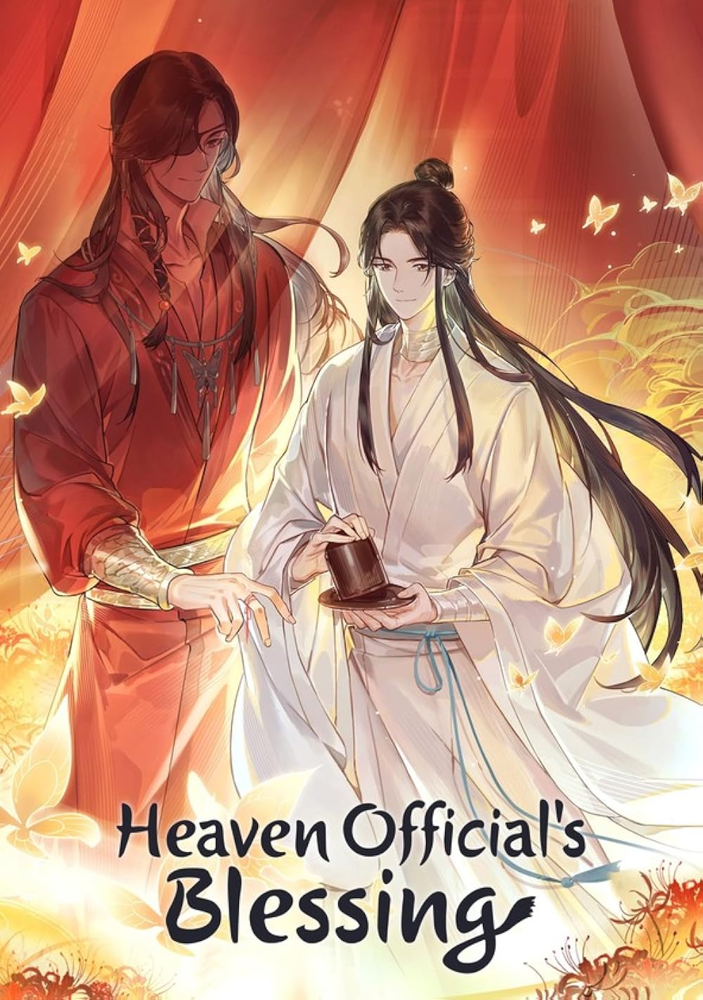

# My Favorite Series: Heaven Official's Blessing

## Introduction

My favorite series is **Heaven Official's Blessing**, also known as *Tian Guan Ci Fu*. It is a Chinese Danmei fantasy series about gods, ghosts, and the journey of Xie Lian, a former crown prince who ascends to heaven but his grace took a downfall.

The story combines *fantasy, adventure, mystery,* and emotional moments that make it interesting to watch and read.

### Why I Like This Series

I like this series because of its beautiful story, memorable characters, and meaningful lessons. It shows the importance of kindness, loyalty, and perseverance, even when life becomes difficult.

> "Even after facing many hardships, a person can still choose to be kind."

### My Favorite Characters

1. **Xie Lian** – A kind and determined former crown prince.
2. **Hua Cheng** – A powerful ghost king who is deeply loyal to Xie Lian.
3. **Feng Xin** – A loyal and strong character who served Xie Lian.

### What Makes It Special

- The story has an interesting plot.
- The characters have unique personalities.
- The animation and artwork are beautiful.
- The series explores themes of love, loyalty, and sacrifice.
- It shows that a person's past does not define their entire future.

### Series Information

| Element | Description |
| --- | --- |
| Title | Heaven Official's Blessing |
| Original Title | Tian Guan Ci Fu |
| Genre | Fantasy, Romance, Adventure |
| Main Character | Xie Lian |
| Rating | 10/10 |

### My Favorite Detail

One of the things I appreciate most is **Hua Cheng's loyalty to Xie Lian**. Their relationship is an important part of the story, and it shows how trust and devotion can remain strong over time.

I would describe the series as `meaningful and unforgettable`.

### My Watchlist

- [x] Watch the first season.
- [x] Watch the second season.
- [ ] Rewatch my favorite episodes.

### A Little Reminder

The series reminds me that ==kindness and perseverance are important==, even when facing challenges.

Water is represented by the chemical formula H~2~O, while a squared number can be written as X^2^ in Markdown.

~~I think a good story only needs action.~~ I believe a good story also needs meaningful characters and emotions that will leave an impact to you.

### Learn More

You can learn more about the series on [MyAnimeList](https://myanimelist.net/anime/40730/Tian_Guan_Ci_Fu).

### Final Thoughts

Overall, *Heaven Official's Blessing* is one of my favorite series because it has an engaging story, interesting characters, and lessons that readers and viewers can appreciate. I would recommend it to anyone who enjoys fantasy stories with emotional depth.
